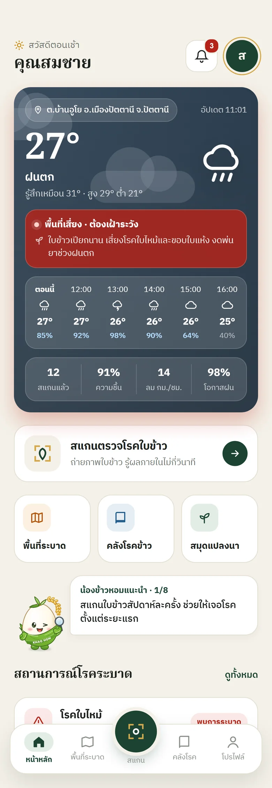
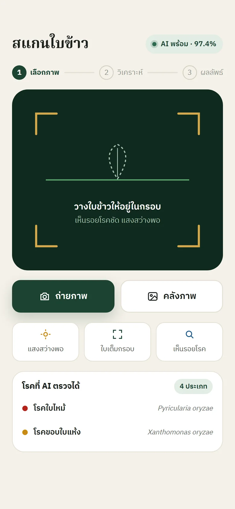
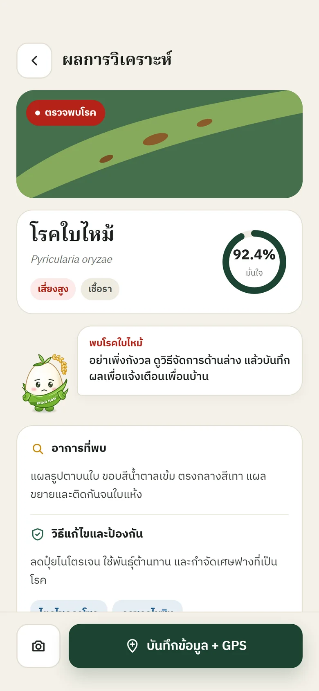
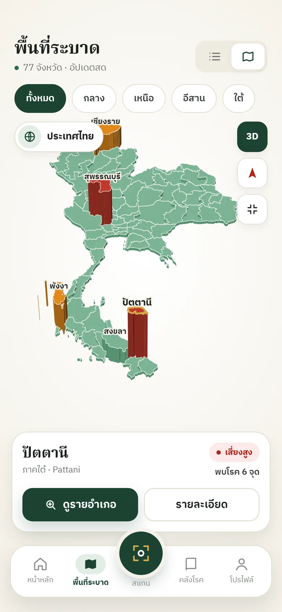

<div align="center">


# Rice AI

**ถ่ายรูปใบข้าว รู้โรคในไม่กี่วินาที · AI ทำงานบนเครื่องของผู้ใช้ ใช้ได้แม้ไม่มีอินเทอร์เน็ต**

[](https://rice-ai-appp.web.app/)
[](https://github.com/BURHANJJ/rice-ai-beta/releases/latest)
[](https://github.com/BURHANJJ/rice-ai-system/actions/workflows/ci.yml)
[](LICENSE)


[ลองใช้งาน](#ลองใช้งาน) · [ทำอะไรได้บ้าง](#ทำอะไรได้บ้าง) · [ผลของโมเดล](#ผลของโมเดล) · [ติดตั้งเอง](#ติดตั้งเป็นของตัวเอง) · [ความปลอดภัย](#ความปลอดภัย) · [English](#english)

</div>

<p align="center">
  
  
  
  
</p>

Rice AI ช่วยเกษตรกรดูว่าใบข้าวเป็นโรคอะไร แยกได้ 4 แบบ คือ โรคไหม้ (Blast) โรคขอบใบแห้ง (Bacterial Leaf Blight) โรคใบสีส้ม (Tungro) และใบปกติ พร้อมคำแนะนำการจัดการจากกรมการข้าว ถ้าภาพดูเป็นโรคอื่นที่ระบบยังไม่รองรับหรือภาพไม่ชัด ระบบจะบอกผู้ใช้ตรง ๆ แทนการเดาชื่อโรค ผลวินิจฉัยที่บันทึกไว้ถูกรวมเป็นแผนที่การระบาดให้นักวิชาการและผู้ดูแลระบบใช้เฝ้าระวัง

โครงงานวิชา สาขาวิชาคอมพิวเตอร์และวิทยาการสารสนเทศเพื่อการจัดการ คณะวิทยาการสื่อสาร มหาวิทยาลัยสงขลานครินทร์ วิทยาเขตปัตตานี ปีการศึกษา 2569

## ลองใช้งาน

| | ลิงก์ | ต้องสมัครไหม |
|---|---|---|
| **เว็บไซต์** | **https://rice-ai-appp.web.app/** | ไม่ต้อง |
| ทดลองสแกนบนเว็บ | https://rice-ai-appp.web.app/try-scan | ไม่ต้อง วันละ 5 ครั้ง ภาพไม่ถูกอัปโหลด |
| คลังความรู้โรคข้าว | https://rice-ai-appp.web.app/rice-diseases | ไม่ต้อง |
| แผนที่การระบาด | https://rice-ai-appp.web.app/risk-map | ไม่ต้อง (ตอนนี้เป็นข้อมูลทดสอบ) |
| การศึกษาและเปรียบเทียบโมเดล | https://rice-ai-appp.web.app/research-study | ไม่ต้อง |
| **แอป Android (รุ่นเบต้า)** | **https://github.com/BURHANJJ/rice-ai-beta/releases/latest** | ไม่ต้อง สมัครในแอปได้เลย |

**ติดตั้งแอป Android**: เปิดลิงก์ด้านบนบนโทรศัพท์ โหลดไฟล์ `…-arm64.apk` (เครื่องรุ่นเก่าที่ติดตั้งไม่ได้ให้ใช้ `…-arm32.apk`) แล้วเปิดไฟล์เพื่อติดตั้ง Android จะถามให้อนุญาตการติดตั้งจากแหล่งนี้หนึ่งครั้ง ต้องใช้ Android 6.0 ขึ้นไป ยังไม่มีรุ่นสำหรับ iPhone ค่า SHA-256 ของไฟล์อยู่ใน `SHA256SUMS.txt` ที่หน้า Release ใช้ตรวจว่าไฟล์ไม่ถูกแก้ไข

## ทำอะไรได้บ้าง

| สำหรับ | ทำอะไรได้ |
|---|---|
| **เกษตรกร** (แอปมือถือ) | สแกนใบข้าวแล้วได้ชื่อโรค ความมั่นใจ และวิธีจัดการ · ใช้ได้โดยไม่มีสัญญาณ ผลซิงก์ภายหลัง · สมุดแปลงนา (ปฏิทินการปลูก บันทึกกิจกรรมและต้นทุน ผลสแกนรอบแปลงในรัศมี 500 ม.) · แผนที่การระบาด 3 มิติ · คลังความรู้โรคข้าว · สภาพอากาศในพื้นที่ · รับแจ้งเตือนจากผู้ดูแลระบบ |
| **ประชาชนทั่วไป** (เว็บ) | ทดลองสแกน คลังความรู้ แผนที่การระบาด ผู้ช่วยตอบคำถาม "น้องข้าวหอม" |
| **นักวิชาการเกษตร** (พอร์ทัลเว็บ) | แผนที่ความเสี่ยงรายอำเภอ ข้อมูลการสแกนพร้อมส่งออก รายงานภาพรวม |
| **ผู้ดูแลระบบ** (พอร์ทัลเว็บ) | แดชบอร์ด ศูนย์แจ้งเตือนการระบาดและส่ง Push ตรวจทานผล AI อนุมัติบัญชีนักวิชาการ จัดการผู้ใช้และคลังความรู้ บันทึกการใช้งาน (audit log) |

**ตัวป้องกันคำตอบผิด**: โมเดลมีคลาสที่ 5 `OTHER` สำหรับโรคอื่นนอกขอบเขต และมีเกณฑ์ความมั่นใจ 60% ภาพที่ต่ำกว่าเกณฑ์จะถูกขอให้ถ่ายใหม่ ภาพโรคอื่นที่ได้ชื่อโรคผิดลดจาก 299 เหลือ 16 จาก 801 ภาพ

## ผลของโมเดล

EfficientNet-B0 เทรนต่อยอดจาก ImageNet (transfer learning) 5 คลาส วัดบนชุดทดสอบที่โมเดลไม่เคยเห็นตอนเทรน

| | รุ่นแรก (Colab) | รุ่นที่ 2 | รุ่นที่ 3 (ใช้งานจริง) |
|---|---|---|---|
| คลาส | 4 | 4 | 4 + โรคอื่น |
| Accuracy 4 คลาส (ชุดทดสอบ 761 ภาพ) | 75.43% | 97.90% | **96.85%** |
| ภาพ 4 คลาสที่ระบบตอบผล | — | 92.8% | **95.7%** |
| ภาพโรคอื่น 801 ภาพที่ได้ชื่อโรคผิด | — | 299 | **16** |
| ROC-AUC (4 คลาส) | — | 0.9992 | 0.9992 |

- **ข้อมูล**: Paddy Doctor (Kaggle) 4 คลาส 5,069 ภาพ + โรคอื่น 6 ชนิด 5,338 ภาพ แบ่ง train / validation / test = 70 / 15 / 15 แบบ stratified
- **ขนาดและความเร็ว**: TFLite 8.1 MB (ราว 12 ms ต่อภาพ วัดบนคอมพิวเตอร์พัฒนา ยังไม่ได้วัดบนโทรศัพท์จริง) · ONNX สำหรับเว็บ 8.2 MB ตรวจแล้วว่าตอบตรงกับโมเดลต้นฉบับทุกภาพจาก 911 ภาพ
- **เทียบ 6 สถาปัตยกรรม** (EfficientNet-B0, MobileNetV3, DenseNet121, VGG16, ResNet50, ConvNeXt-Tiny) ตัวละ 3 รอบ เลือก B0 เพราะแม่นเท่า ConvNeXt-Tiny แต่ไฟล์เล็กกว่าเกือบ 7 เท่า: [`ai-service/model-comparison/`](ai-service/model-comparison/README.md)
- **วิธีเทรนและทำซ้ำ**: [`ai-service/training/`](ai-service/training/README.md)

ภาพทั้งหมดมาจากนาในอินเดีย ผลกับนาไทยอาจต่างไป ระบบจึงมีหน้าตรวจทานผล AI ไว้เก็บภาพจริงมาเทรนเพิ่ม

## สถาปัตยกรรม

การวิเคราะห์ภาพทำ**บนอุปกรณ์ของผู้ใช้**ทั้งหมด ข้อมูลอยู่บน Firebase ไม่มีเซิร์ฟเวอร์ AI ที่ต้องดูแลและไม่มีค่าเรียก API ต่อภาพ

```
แอปมือถือ (Flutter)   โมเดล TensorFlow Lite บนเครื่อง ──┐   ใช้ได้แม้ไม่มีสัญญาณ
เว็บ (React)          โมเดล ONNX Runtime Web ในเบราว์เซอร์ ┤   ภาพไม่ต้องส่งออกจากเครื่อง
                                                          │
                                                          ▼
        Firebase: Authentication · Firestore (Security Rules) · Hosting · Cloud Messaging · Cloud Functions
```

| โฟลเดอร์ | คืออะไร | เทคโนโลยี |
|---|---|---|
| [`mobile/`](mobile) | แอปเกษตรกร | Flutter 3.24, TensorFlow Lite, Firebase |
| [`web/`](web) | เว็บสาธารณะ ทดลองสแกน และพอร์ทัลนักวิชาการ/ผู้ดูแลระบบ | React 19, Vite, Tailwind CSS 4, ONNX Runtime Web, Leaflet, Recharts |
| [`ai-service/`](ai-service) | เทรน ประเมินผล เปรียบเทียบสถาปัตยกรรม และไฟล์โมเดลต้นฉบับ | Python, Keras 3, TensorFlow / PyTorch |
| [`functions/`](functions) | Push แจ้งเตือนการระบาด และแชทบอทโหมด AI (ไม่บังคับ) | Cloud Functions (แผน Blaze) |
| [`firestore.rules`](firestore.rules) · [`tests/firestore/`](tests/firestore) | กฎความปลอดภัยของฐานข้อมูล และชุดทดสอบกฎ | Firestore Emulator |
| [`scripts/`](scripts) | สคริปต์ดูแลระบบที่ต้องใช้สิทธิ์ผู้ดูแล (ตั้งผู้ดูแลระบบคนแรก) | Firebase Admin SDK |
| [`docs/`](docs) | คู่มือติดตั้ง | — |

## ติดตั้งเป็นของตัวเอง

repo นี้ไม่มีกุญแจหรือค่าตั้งค่าของโปรเจกต์จริง ถ้าจะรันของตัวเองต้องมีโปรเจกต์ Firebase ของตัวเอง (แผนฟรีพอสำหรับทดลอง) ขั้นตอนทั้งหมดอยู่ใน **[docs/SETUP.md](docs/SETUP.md)** สรุปสั้น ๆ:

```bash
git clone https://github.com/BURHANJJ/rice-ai-system.git && cd rice-ai-system

# 1) สร้างโปรเจกต์ Firebase เปิด Authentication (Email/Password, Google) และ Firestore
#    แล้วใส่ค่าของเว็บแอปใน web/.env.local (ดูตัวอย่างใน web/.env.example)
cd web && cp .env.example .env.local && npm ci && npm run dev      # http://localhost:5173

# 2) ส่งกฎความปลอดภัย (แก้ project id ใน .firebaserc ก่อน)
firebase deploy --only firestore:rules,firestore:indexes

# 3) ตั้งผู้ดูแลระบบคนแรก (ใช้ Admin SDK ดู docs/SETUP.md)
cd ../scripts && npm ci && node make-admin.mjs you@example.com

# 4) แอปมือถือ: สร้าง firebase_options.dart ด้วย flutterfire configure แล้ว
cd ../mobile && flutter pub get && flutter run
```

ไฟล์โมเดลที่เทรนแล้ว (TFLite, ONNX, Keras) รวมอยู่ใน repo แล้ว ไม่ต้องเทรนเองก็ใช้งานได้

## ความปลอดภัย

- ไม่มีรหัสผ่าน กุญแจลับ หรือค่าตั้งค่าโปรเจกต์จริงใน repo ค่า Firebase ของเว็บอ่านจาก `web/.env.local` ส่วนของแอปมือถืออยู่ในไฟล์ที่ไม่ถูก commit
- การเข้าถึงข้อมูลคุมด้วย [`firestore.rules`](firestore.rules) และมีชุดทดสอบ 24 ข้อ ([`tests/firestore`](tests/firestore)) ครอบคลุมการยกระดับสิทธิ์ การแก้ไข log และข้อมูลส่วนตัวของผู้ใช้
- ตั้งผู้ดูแลระบบได้ด้วย Admin SDK เท่านั้น ผู้ใช้แก้ role หรือ status ของตัวเองไม่ได้
- การวิเคราะห์ภาพทำบนเครื่อง ไม่ส่งภาพไปเซิร์ฟเวอร์ AI เว็บทดลองสแกนไม่อัปโหลดภาพเลย ส่วนแอปจะบันทึกผล รูปย่อ และพิกัดลงบัญชีผู้ใช้บน Firebase ตามที่ผู้ใช้สแกน

รายละเอียด วิธีแจ้งช่องโหว่ และข้อจำกัดที่รู้อยู่: **[SECURITY.md](SECURITY.md)**

## ทดสอบ

```bash
cd web && npm run lint && npm run build                  # เว็บ (ต้องมี web/.env.local)
cd mobile && flutter analyze && flutter test              # แอป (ต้องมี firebase_options.dart ดู docs/SETUP.md)
cd tests/firestore && npm ci && npm test                  # กฎความปลอดภัย (ต้องมี Java 21+)
cd ai-service/training && python test_eval.py             # ประเมินโมเดลบนชุดทดสอบ (ต้องมีภาพ ดู training/README.md)
```

## ข้อมูลและการอ้างอิง

- ภาพสำหรับเทรน: **Paddy Doctor** (Kaggle) ไม่ได้แจกจ่ายใน repo นี้ ดาวน์โหลดเองตามเงื่อนไขของผู้เผยแพร่
- เนื้อหาและภาพคลังความรู้โรคข้าว อ้างอิงข้อมูลจาก **Rice Knowledge Bank กรมการข้าว** ตรวจสอบเงื่อนไขการใช้ซ้ำก่อนนำไปเผยแพร่ต่อ
- ขอบเขตการปกครอง: ชุดข้อมูลเปิดที่แนบใน `web/src/lib/*.json` · แผนที่พื้นหลัง © ผู้ร่วมจัดทำ OpenStreetMap
- ตัวละคร "น้องข้าวหอม" และโลโก้เป็นผลงานของโครงงานนี้
- รายการวัสดุของบุคคลที่สามที่ไม่อยู่ใต้สัญญาอนุญาต MIT: [NOTICE](NOTICE)

## ผู้จัดทำ

นายบุรฮาน จิ้วจวบ · อาจารย์ที่ปรึกษา ดร.ดารานาถ แต่นสุ่ย · สาขาวิชาคอมพิวเตอร์และวิทยาการสารสนเทศเพื่อการจัดการ คณะวิทยาการสื่อสาร มหาวิทยาลัยสงขลานครินทร์ วิทยาเขตปัตตานี

แจ้งปัญหาหรือเสนอแนะ: [Issues](https://github.com/BURHANJJ/rice-ai-system/issues) · ดู [CONTRIBUTING.md](CONTRIBUTING.md)

## English

**Rice AI** is an on-device rice leaf disease classifier with a farmer app (Flutter), a public website and research/admin portals (React), all on Firebase. An EfficientNet-B0 model (96.85% accuracy on a held-out 761-image test set; it rejects out-of-scope diseases and low-confidence photos instead of guessing) runs on the phone via TensorFlow Lite and in the browser via ONNX Runtime Web, so no photo has to be sent to an AI server and there is no AI server to run.

- **Live demo**: https://rice-ai-appp.web.app/ (no sign-up needed for the trial scan)
- **Android beta**: https://github.com/BURHANJJ/rice-ai-beta/releases/latest
- **Run your own copy**: this repository ships no credentials or project config. Create a Firebase project and follow [docs/SETUP.md](docs/SETUP.md). The trained models are included.
- **Security**: [SECURITY.md](SECURITY.md). The Firestore rules are covered by emulator tests in [`tests/firestore`](tests/firestore).
- **License**: MIT, see [LICENSE](LICENSE). The training data (Paddy Doctor) and the disease-library content from the Thai Rice Department are third-party and not covered by it, see [NOTICE](NOTICE).
