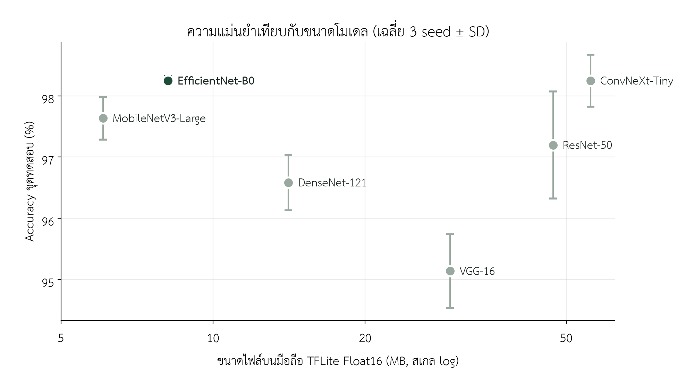
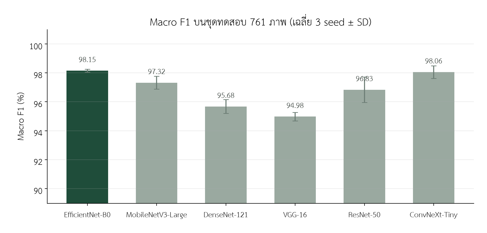
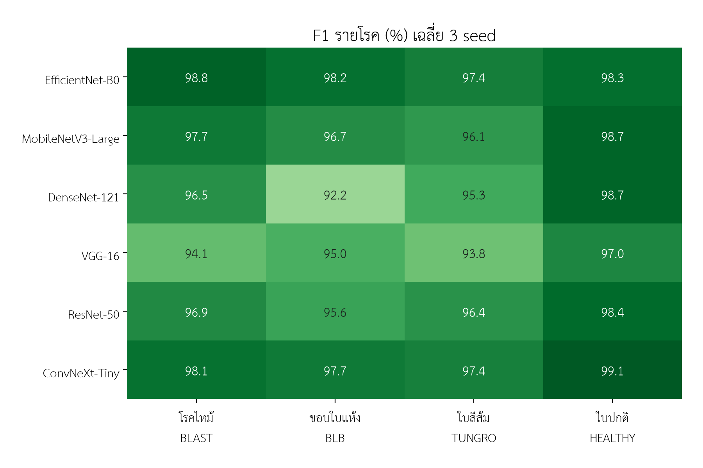
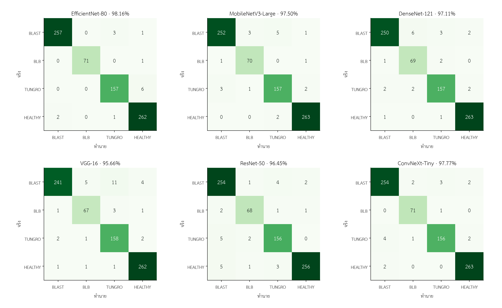
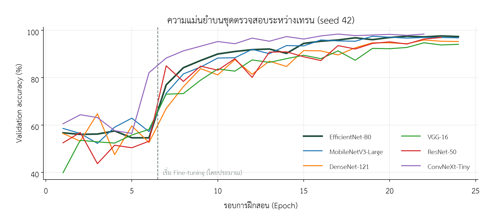

# ผลเปรียบเทียบโมเดล

วัดบนภาพทดสอบ 761 ภาพชุดเดียวกับโมเดลที่ใช้งานจริง · ค่าเฉลี่ย ± SD จาก 3 seed (42, 7, 2026) · วัดผลเมื่อ 2026-10-17

## ตารางรวม (เรียงตาม Accuracy)

| # | โมเดล | Accuracy | Macro F1 | AUC | พารามิเตอร์ | GFLOPs | ไฟล์ TFLite | เวลา/ภาพ (CPU) | เวลาเทรน (GPU) |
|---|---|---|---|---|---|---|---|---|---|
| 1 | **EfficientNet-B0** | 98.25 ± 0.08% | 98.15 ± 0.10% | 0.9993 | 4.1M | 0.80 | 8.1 MB | 7.0 ms | 15.1 นาที |
| 2 | ConvNeXt-Tiny | 98.25 ± 0.42% | 98.06 ± 0.43% | 0.9993 | 27.8M | 8.76 | 55.9 MB | 44.3 ms | 19.5 นาที |
| 3 | MobileNetV3-Large | 97.63 ± 0.35% | 97.32 ± 0.44% | 0.9989 | 3.0M | 0.44 | 6.1 MB | 2.3 ms | 13.0 นาที |
| 4 | ResNet-50 | 97.20 ± 0.87% | 96.83 ± 0.88% | 0.9981 | 23.6M | 7.75 | 47.1 MB | 21.3 ms | 16.5 นาที |
| 5 | DenseNet-121 | 96.58 ± 0.46% | 95.68 ± 0.48% | 0.9968 | 7.0M | 5.70 | 14.1 MB | 18.4 ms | 31.5 นาที |
| 6 | VGG-16 | 95.14 ± 0.60% | 94.98 ± 0.30% | 0.9956 | 14.7M | 30.71 | 29.5 MB | 81.2 ms | 20.9 นาที |

เวลาต่อภาพวัดจาก TFLite Float16 บน CPU Intel Core i5-12450H 4 threads (ค่ามัธยฐาน) · GFLOPs นับการคูณและบวกแยกกัน

โมเดลที่ใช้งานจริง (EfficientNet-B0 V2 เทรนบน CPU) ได้ Accuracy 97.90% Macro F1 97.78% บนชุดทดสอบเดียวกัน
ส่วน EfficientNet-B0 ในตารางคือการเทรนซ้ำบน GPU ภายใต้เงื่อนไขเดียวกับโมเดลอื่น

## F1 รายโรค (%) เฉลี่ย 3 seed

| โมเดล | BLAST | BLB | TUNGRO | HEALTHY |
|---|---|---|---|---|
| EfficientNet-B0 | 98.78 | 98.15 | 97.42 | 98.25 |
| ConvNeXt-Tiny | 98.08 | 97.68 | 97.35 | 99.12 |
| MobileNetV3-Large | 97.75 | 96.74 | 96.12 | 98.69 |
| ResNet-50 | 96.89 | 95.60 | 96.43 | 98.42 |
| DenseNet-121 | 96.51 | 92.24 | 95.26 | 98.68 |
| VGG-16 | 94.11 | 94.96 | 93.81 | 97.03 |

## McNemar test: EfficientNet-B0 เทียบกับแต่ละโมเดล

แต่ละช่องเรียงตาม seed 42, 7, 2026 · p < 0.05 = ต่างกันอย่างมีนัยสำคัญ

| โมเดล | B0 ถูก / ตัวนั้นผิด | ตัวนั้นถูก / B0 ผิด | p-value |
|---|---|---|---|
| ConvNeXt-Tiny | 10 · 6 · 4 | 7 · 8 · 5 | 0.629 · 0.791 · 1.000 |
| MobileNetV3-Large | 11 · 12 · 9 | 6 · 5 · 7 | 0.332 · 0.143 · 0.804 |
| ResNet-50 | 20 · 18 · 9 | 7 · 8 · 8 | 0.019 · 0.076 · 1.000 |
| DenseNet-121 | 14 · 22 · 19 | 6 · 7 · 4 | 0.115 · 0.008 · 0.003 |
| VGG-16 | 27 · 35 · 28 | 8 · 6 · 5 | 0.002 · <0.001 · <0.001 |

## กราฟ

